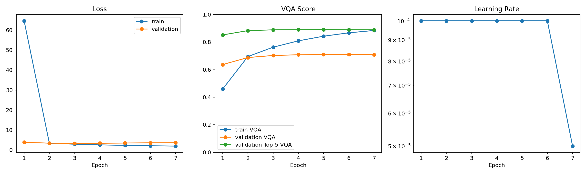

# Model Card / 模型说明

## Overview / 概览

[BEiT-3 Base A](#recommended-model-beit-3-base-a) is the recommended model at **74.22** on VQA v2 public validation. Get its inference package from [Release `beit3-a-v1`](https://github.com/dongtingshuo/multimodal-vqa/releases/tag/beit3-a-v1). ViLT `v0.3.0` (68.42) remains the fallback.

[BEiT-3 Base A](#recommended-model-beit-3-base-a) 是首选模型，VQA v2 公开验证分数为 **74.22**。从 [Release `beit3-a-v1`](https://github.com/dongtingshuo/multimodal-vqa/releases/tag/beit3-a-v1) 下载推理包。ViLT `v0.3.0`（68.42）保留为备选。

### Public ViLT fallback / 公开下载备选 ViLT

The following release details, training configuration and primary validation tables describe ViLT; BEiT-3 has its own section below. / 以下发布信息、训练配置和主要验证表对应 ViLT；BEiT-3 的详细信息见后文独立小节。

- **Task / 任务**: open-ended Visual Question Answering
- **Release / 发布**: [v0.3.0](https://github.com/dongtingshuo/multimodal-vqa/releases/tag/v0.3.0)
- **Checkpoint / 权重**: `best.pt`
- **Architecture / 架构**: ViLT joint vision-language transformer + Top-3000 classifier
- **Source backbone / 源模型**: `dandelin/vilt-b32-mlm-itm`
- **Processor / 处理器**: `dandelin/vilt-b32-finetuned-vqa`
- **Checkpoint format / 格式**: format v3
- **Size / 大小**: 1,409,005,580 bytes
- **SHA256**: `0cce251f02a7b5349b90c0a6e41850168cc01a700f36fe03663887bae7dbf213`

## Intended Use / 预期用途

The checkpoint is intended for English VQA research, reproducible internal evaluation,
single-image inference, and the included Gradio demonstration. It predicts answers from a fixed
Top-3000 normalized vocabulary. It is not a general-purpose generative VLM and is not intended
for safety-critical decisions.

该权重适用于英文 VQA 研究、可复现内部评估、单图推理和仓库内 Gradio 演示。模型从固定的
Top-3000 规范化答案词表中预测，不是通用生成式视觉语言模型，也不适用于安全关键决策。

## Training Data / 训练数据

- VQA v2 train/validation questions and annotations
- COCO 2014 `train2014` and `val2014` images
- 443,757 training questions and 214,354 validation questions passed strict data validation
- 434,635 training examples and 209,608 validation examples were internally scorable under the
  Top-3000 answer vocabulary

- VQA v2 训练/验证 questions 与 annotations
- COCO 2014 `train2014` 与 `val2014` 图像
- 443,757 条训练问题和 214,354 条验证问题通过严格数据校验
- Top-3000 答案词表下可参与内部评分的训练/验证样本分别为 434,635 / 209,608

## Training Configuration / 训练配置

```yaml
seed: 42
model:
  name: vilt
  pretrained_model_name: dandelin/vilt-b32-mlm-itm
  gradient_checkpointing: true
  trainable_layers: 12
data:
  processor_name: dandelin/vilt-b32-finetuned-vqa
  image_size: 384
  max_question_length: 40
  answer_vocab_size: 3000
train:
  batch_size: 4
  gradient_accumulation_steps: 8
  lr: 0.0001
  backbone_lr: 0.00002
  weight_decay: 0.01
  scheduler: warmup_plateau
  early_stopping_patience: 2
  selection_metric: vqa_score
  use_amp: true
```

Epochs 1-2 ran on a Kaggle P100. The format-v3 checkpoint was then continued on one AutoDL
RTX 4090D through epoch 7, where the configured early-stopping rule ended training. Optimizer,
scheduler, AMP scaler, RNG, history, and global-step state were restored at the epoch boundary.

epoch 1-2 在 Kaggle P100 上运行；随后通过 format-v3 checkpoint 在单卡 AutoDL RTX 4090D
上续训至 epoch 7，并按配置触发早停。续训在 epoch 边界恢复 optimizer、scheduler、AMP
scaler、随机数、历史和 global step 状态。

## Validation Results / 验证结果

| Epoch | Train VQA | Val loss | Hard accuracy | Internal VQA | Top-5 VQA | Best |
| ---: | ---: | ---: | ---: | ---: | ---: | :---: |
| 1 | 0.4591 | 3.8765 | 0.5395 | 0.6368 | 0.8519 | yes |
| 2 | 0.6949 | 3.4327 | 0.5891 | 0.6879 | 0.8832 | yes |
| 3 | 0.7629 | 3.3596 | 0.6050 | 0.7027 | 0.8888 | yes |
| 4 | 0.8090 | 3.3900 | 0.6103 | 0.7079 | 0.8899 | yes |
| **5** | **0.8427** | **3.5019** | **0.6126** | **0.7101** | **0.8908** | **yes** |
| 6 | 0.8672 | 3.6097 | 0.6126 | 0.7099 | 0.8895 | no |
| 7 | 0.8843 | 3.6601 | 0.6120 | 0.7089 | 0.8889 | no |

Epoch 5 is selected by validation VQA score. Epochs 6-7 increased training performance while
validation VQA score and loss worsened, providing direct evidence of overfitting and justifying
the early stop.

模型按验证 VQA score 选择 epoch 5。epoch 6-7 的训练指标继续提高，但验证 VQA score 与
loss 变差，直接表明过拟合，因此早停是合理的。

The final prediction export contains 214,354 unique records. Their question IDs exactly match
the complete official validation questions and annotations. A separate full project evaluation
of the selected checkpoint reported hard accuracy `0.6127`, internal VQA score `0.7102`, Top-5
VQA score `0.8908`, and loss `3.5019`.

最终预测文件包含 214,354 条唯一记录，question ID 与完整官方验证 questions 和 annotations
完全一致。对最佳权重的独立项目全量复评结果为：硬准确率 `0.6127`、内部 VQA score
`0.7102`、Top-5 VQA score `0.8908`、loss `3.5019`。



## Evaluation Scope / 评估范围

The official VQA Evaluation Toolkit reports `68.42` overall on all 214,354 VQA v2 validation
questions, with `85.88` yes/no, `60.40` other, and `48.54` number accuracy. The evaluation uses
official repository commit `a013f004` and the public validation annotations. Full provenance and
input hashes are recorded in
[`docs/evaluation/v0.3.0-official-vqa.md`](docs/evaluation/v0.3.0-official-vqa.md).

官方 VQA Evaluation Toolkit 在全部 214,354 条 VQA v2 验证问题上的 overall 为 `68.42`，
其中 yes/no `85.88`、other `60.40`、number `48.54`。评测使用官方仓库 commit `a013f004`
和公开验证标注；完整溯源与输入哈希见
[`docs/evaluation/v0.3.0-official-vqa.md`](docs/evaluation/v0.3.0-official-vqa.md)。

This is an official-protocol local validation result, not a test-dev/test-standard server
submission. No leaderboard or cross-project state-of-the-art claim is made.

这是采用官方协议的本地验证结果，不是 test-dev/test-standard 服务器提交成绩；不作
leaderboard 或跨项目 SOTA 声明。

## Comparison / 对比

| Checkpoint | Hard accuracy | Internal VQA | Official VQA val (%) | Status |
| --- | ---: | ---: | ---: | --- |
| BEiT-3 Base A (epoch 9 of 10) | **0.6667** | **0.7546** | **74.22** | Recommended inference release |
| ViLT seed 42 (`v0.3.0`) | 0.6126 | 0.7101 | 68.42 | Public fallback |
| Staged cross-attention (`v0.2.0`) | 0.5239 | 0.6233 | not evaluated | Archived comparison release |
| Strong cross-attention ablation | 0.4967 | 0.5955 | not evaluated | Not promoted |
| Legacy checkpoint (`v0.1.0`) | 0.4775 | not recorded | not evaluated | Archived |

## Recommended Model: BEiT-3 Base A

BEiT-3 A completed 10 epochs on dual T4. The recommended epoch-9 checkpoint (step 30763) scored **74.22** on all 214,354 public validation questions in two matching official-toolkit runs: yes/no 89.95, other 66.39, number 58.60. Epoch 10 (step 34181) tied; its `latest.pt` is the terminal training state, not the selected model. Internal metrics cover 210,834 vocabulary-covered examples. The 75.00 research target was not met, and no independent-seed training was run.

BEiT-3 A 在双 T4 上完成 10 轮。首选的第 9 轮权重（step 30763）在 214,354 道公开验证题上两次官方工具复评均为 **74.22**：yes/no 89.95、other 66.39、number 58.60。第 10 轮（step 34181）同分，`latest.pt` 保留最终训练状态，不是最佳权重。内部指标覆盖词表内的 210,834 条样本。原定 75.00 的研究目标未达到，也未进行独立 seed 训练。

[Official metrics / 官方指标](docs/evaluation/beit3-a-official-vqa-metrics.json) · [Provenance and checkpoint hashes / 核验记录与权重哈希](docs/evaluation/beit3-a-official-vqa-provenance.json)

| Property | Value |
| --- | --- |
| Model ID | `beit3_base` |
| Architecture | BEiT-3 Base, 12 encoder layers, hidden size 768, VQA pooling/classification head |
| Pretraining | Generic BEiT-3 Base pretraining; no VQA-finetuned or in-domain checkpoint |
| Image input | 480 x 480, official BEiT-3 VQA resize/bicubic and normalization path |
| Text tokenizer | Official `beit3.spm` SentencePiece model |
| Answer space | Top-5000 built from VQA v2 training annotations only, VQA-v2 answer normalization |
| Upstream implementation license | MIT, per the [Microsoft UniLM repository](https://github.com/microsoft/unilm) |
| TorchScale source | [`4d1e0e82e5adf86dd424f1463192635b73fc8efc`](https://github.com/microsoft/torchscale/tree/4d1e0e82e5adf86dd424f1463192635b73fc8efc) |
| Pretrained weights | [`beit3_base_patch16_224.pth`](https://github.com/addf400/files/releases/download/beit3/beit3_base_patch16_224.pth), 554,351,015 bytes |
| Upstream pretrained weights SHA-256 | `12ebc3d487f418d4f0f000d09719edfe7dcc89079da427f5580a7fb86ee3943a` |
| Released checkpoint | `best.pt`, epoch 9/update 30763, FP32 inference export, 924,193,528 bytes |
| Released checkpoint SHA-256 | `8d40a588cdedb124cfe48b05cdc726fb479ae7f0830888ab0a4c32d49e2d9ffd` |
| Original training checkpoint SHA-256 | `31951eb590d1fa4df887deac5c43b90ee5b478126c401ce43476911c1370bab7` |
| Tokenizer SHA-256 | `6f5e2fefcf793761a76a6bfb8ad35489f9c203b25557673284b6d032f41043f4` |
| Training plan | A: VQA v2 only; B: screened Visual Genome QA; C: independent seed-123 replication |
| Status | A completed; official-toolkit result verified twice. B and C have not run. |

Upstream VQAv2 preprocessing, answer normalization, and the classification-head layout are adapted from Microsoft's [BEiT-3 VQAv2 guide](https://github.com/microsoft/unilm/blob/master/beit3/get_started/get_started_for_vqav2.md) and [official implementation](https://github.com/microsoft/unilm/tree/master/beit3). The base checkpoint is downloaded from the upstream-linked release location and rejected if its expected size or SHA-256 does not match. Kaggle preflight benchmarks per-GPU batches 1/2/4/8, writes a runtime config preserving global batch 128, performs a real distributed checkpoint round-trip, and records a cautious throughput-based epoch/session estimate. The local integration test loaded all 12 encoder layers and verified the 480 px positional-embedding interpolation; these are implementation checks, not training results.

上游 VQAv2 图像预处理、答案规范化和分类头结构参考 Microsoft 的 [BEiT-3 VQAv2 指南](https://github.com/microsoft/unilm/blob/master/beit3/get_started/get_started_for_vqav2.md)及[官方实现](https://github.com/microsoft/unilm/tree/master/beit3)。Base 权重从上游指向的发布地址下载，文件大小或 SHA-256 不匹配时会拒绝加载。Kaggle 预检会测量每卡 batch 1/2/4/8、生成保持全局 batch 128 的运行配置、执行真实分布式 checkpoint 往返验证，并按吞吐记录审慎的 epoch/会话估算。本地集成测试已加载全部 12 层 encoder，并检查 480 px 位置编码插值；这些都只是实现检查，不代表训练结果。

The recommendation is based on the highest verified full-validation score. The inference export contains the exact 497 FP32 tensors from the selected checkpoint, with no optimizer or resume state. Publication does not imply the original research targets were met or replace the prior ViLT release. Repeated evaluation of one model is not independent training replication.

首选模型依据已核验的最高全量验证分数确定。推理包原样保留选中权重的 497 个 FP32 张量，不包含优化器或续训状态。发布不代表原研究目标已达成，也不覆盖之前的 ViLT 版本。同一权重的重复评测不能替代独立训练复现。

## Runtime Requirements / 运行要求

For BEiT-3, install the optional dependencies with `python -m pip install -e '.[beit3]'`. Use the verified epoch-9 checkpoint with `beit3.spm` beside it; see the [local inference example](README.md#recommended-beit-3-a--首选beit-3-a).

BEiT-3 需安装上述可选依赖，并将 `beit3.spm` 与第 9 轮权重放在同一目录，见[本地推理示例](README.md#recommended-beit-3-a--首选beit-3-a)。

The public ViLT release stores trained model parameters and checkpoint-owned preprocessing configuration.
Runtime construction also requires the Hugging Face ViLT backbone and processor assets. Cache
them once in an online environment before using `demo.py --offline`.

发布权重保存训练参数和 checkpoint 自带的预处理配置。运行时还需要 Hugging Face ViLT
backbone 与 processor 资源；首次联网缓存后，才可使用 `demo.py --offline`。

```bash
python scripts/download_checkpoint.py
python demo.py --checkpoint checkpoints/best.pt
```

## Limitations / 局限

- Fixed answer vocabularies (5,000 answers for BEiT-3, 3,000 for ViLT) cannot represent every valid answer.
- The default language path expects English questions.
- COCO/VQA domain bias and annotation bias remain present.
- Confidence values are classifier scores and are not calibrated guarantees.
- The `74.22` and `68.42` scores are public validation results, not hidden evaluation-server results.

- 固定答案词表无法覆盖所有有效答案：BEiT-3 为 5,000 条，ViLT 为 3,000 条。
- 默认语言路径面向英文问题。
- 仍存在 COCO/VQA 数据域与标注偏差。
- 置信度是分类器分数，不是经过校准的保证。
- `74.22` 和 `68.42` 均为公开验证集结果，不是隐藏测试服务器成绩。

## Security / 安全

PyTorch checkpoints use pickle-based serialization. Load only trusted experiment artifacts or official project releases and verify the recorded SHA-256 first.

PyTorch checkpoint 使用基于 pickle 的序列化。仅加载可信实验产物或项目官方发布权重，并先校验记录中的 SHA-256。
